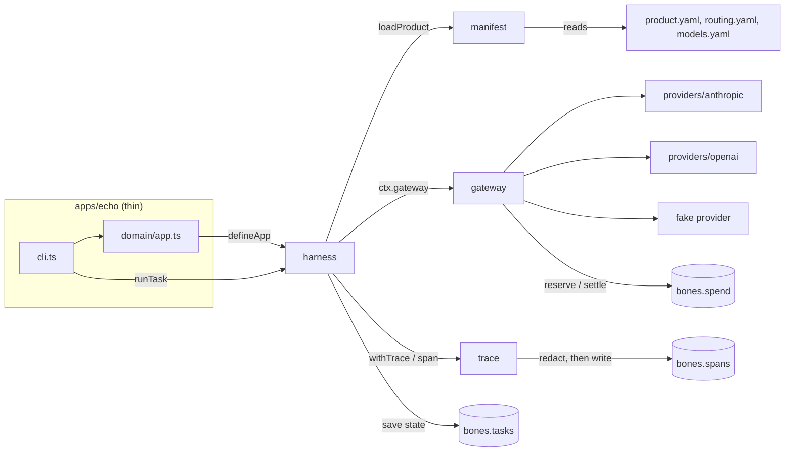
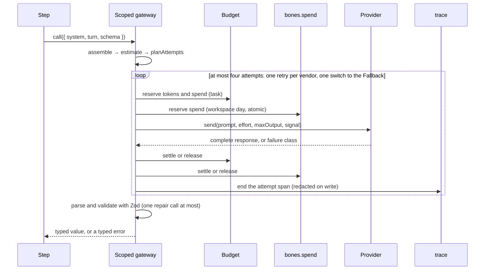

# Design Document

Spec `01-skeleton-core` (Phase 1).

## Overview

Phase 1 fills five skeleton modules and adds one throwaway app. Every module keeps its decisions in pure functions that take data and return data. A thin layer does the I/O (files, network, database, clock), so the properties can test the decisions directly.

| Module | Folder | Pure core | I/O shell | Requirements | Properties |
| --- | --- | --- | --- | --- | --- |
| `manifest` | `src/manifest/` | schemas, policy tables, `resolvePolicy` | `loadProduct` reads three YAML files | 2 to 8 | 1, P1-1 |
| `gateway` | `src/gateway/` | `assemble`, `estimate`, `planAttempts`, `price`, `parseStructured` | `createGateway`, two vendor adapters, `bones.spend` | 9 to 15, 24, 25 | 5, 6, P1-5 |
| `harness` | `src/harness/` | `Budget` arithmetic, task-state schema, round logic | `defineApp`, `runTask`, `bones.tasks` | 16 to 20 | 2, P1-2, P1-3 |
| `db` | `src/db/` | Drizzle schema | `createDb` (Phase 0), migration 0001 | 21 | none |
| `trace` | `src/trace/` | `redact`, attribute names | `withTrace`, `span`, `bones.spans` | 22, 23 | 8, P1-4 |
| Echo | `apps/echo/` | word-limit check | CLI | 26 | end-to-end test |

The skeleton's line target is roughly 2,500 lines across all phases (plan §6). Phase 1 aims for about 1,300 non-test lines, so Phases 2 and 3 have room.

All decisions are approved and recorded in `docs/decisions.md`. D-42 to D-61 come from the requirements round. D-62 to D-69 were taken in this design and are listed at the end. D-70 (rate limits) and D-71 (calibration without keys) came from your design-round answers and changed the requirements as well.

## Repository changes

```text
packages/skeleton/
├── package.json            + zod, yaml, @anthropic-ai/sdk, openai; dev fast-check; script "smoke"
├── vitest.smoke.config.ts  includes only **/*.smoke.ts
└── src/
    ├── index.ts            the public entry (Requirement 1.1)
    ├── errors.ts           every typed error class
    ├── money.ts            micro-dollar conversion (D-46)
    ├── manifest/  schemas.ts  policy.ts  load.ts  (+ tests)
    ├── gateway/   types.ts  assemble.ts  estimate.ts  calibration.ts  plan.ts  price.ts  structured.ts
    │              spend.ts  gateway.ts  fake.ts  (+ tests)
    │              providers/  anthropic.ts  openai.ts  classify.ts  vendors.smoke.ts
    │              fixtures/   token-corpus.ts  token-counts.json
    ├── harness/   budget.ts  task-state.ts  define-app.ts  run-task.ts
    │              pipeline.ts  generate-evaluate.ts  (+ tests)
    ├── trace/     attributes.ts  redact.ts  trace.ts  (+ tests)
    └── db/        schema.ts (bones tables)  migrations/0001_bones.sql  migrate.test.ts (updated)
apps/echo/
├── package.json  tsconfig.json  turbo.json  product.yaml  routing.yaml
├── prompts/  generate.md  rubric.md
└── src/  domain/app.ts  domain/word-limit.ts  cli.ts  echo.e2e.test.ts
```

Other files touched: `pnpm-lock.yaml`, `docs/decisions.md`, `docs/kiro-log.md`, `CHANGELOG.md`, and the README bones table (Requirement 27.3). `turbo.json`, the two app `turbo.json` files and `scripts/test/model-register.test.ts` were already changed in the requirements round (D-61).

**Dependencies.** `zod` (v4, for `z.toJSONSchema`), `yaml` (already in the catalog), `@anthropic-ai/sdk`, `openai`, and `fast-check` as a dev dependency. Each is pinned exactly at the latest stable version on the day of install. The two vendor SDKs are imported only from `src/gateway/providers/` (MODEL-01). If an SDK's types lag behind a request field this design uses (`output_config.effort`, `prompt_cache_options`), the adapter passes the field through the SDK's extra-body option and a comment names the field.

## Architecture



One model call, from a Step to a vendor and back:



## Manifest

### Schemas (`manifest/schemas.ts`)

All three schemas use `z.strictObject` so an unknown key fails (D-58).

```ts
const ModelId = z.string().regex(/^[a-z][a-z0-9-]*:[^\s:]+$/);
const Usd = z.number().nonnegative().refine(atMostSixDecimals);   // D-62

export const ProductSchema = z.strictObject({
  id: z.string().regex(/^[a-z][a-z0-9-]*$/),
  name: z.string().min(1),
  code: z.string(),                          // checked by resolvePolicy, so errors name the bad part
  users: z.string().min(1),
  market: z.array(z.string().regex(/^[A-Z]{2}$/)).min(1),
  north_star: z.string().min(1),
  pricing: z.strictObject({ model: z.string(), unit: z.string(), currency: z.string().regex(/^[A-Z]{3}$/) }),
  routing: z.string(),
  evals: z.strictObject({ dir: z.string(), core_set: z.string() }),
  limits: z.strictObject({
    max_steps: z.int().positive(), max_tokens: z.int().positive(), max_seconds: z.int().positive(),
    max_spend_usd: Usd.positive(), max_workspace_spend_usd_per_day: Usd.positive(),
  }),
  interfaces: z.strictObject({
    mcp: z.strictObject({ path: z.string(), tools: z.array(z.string()) }).optional(),
    skills: z.array(z.string()).optional(),
  }).optional(),
  costume: z.string().optional(),
  release: z.strictObject({ threshold: z.number().min(0).max(1) }).optional(),
});

const ModelStep = z.strictObject({
  tier: z.enum(["small", "mid", "frontier"]), effort: z.enum(["low", "medium", "high"]),
  role: z.literal("judge").optional(),
  timeout_ms: z.int().min(1_000).max(300_000).optional(),
  max_output_tokens: z.int().min(1).max(64_000).optional(),
  max_retry_wait_ms: z.int().min(0).max(2_000).optional(),     // D-70; default 2,000
});
export const RoutingSchema = z.strictObject({
  steps: z.record(z.string().regex(/^[a-z][a-z0-9_-]*$/), z.union([ModelStep, z.strictObject({ kind: z.literal("code") })])),
}).refine((r) => Object.keys(r.steps).length > 0);

const Price = z.strictObject({
  input: Usd, cached_input: Usd, cache_write_input: Usd.optional(), output: Usd,
  max_prompt_tokens: z.int().positive().optional(), image_input_tokens: z.int().positive().optional(),
  currency: z.literal("USD"), source: z.url(), checked: z.iso.date(),
});
export const ModelsSchema = z.strictObject({
  tiers: z.strictObject({ small: Tier, mid: Tier, frontier: Tier }),   // Tier = { primary, fallback }
  prices: z.record(ModelId, Price),
});
```

The YAML parser runs with `{ schema: "core" }`, and the `checked` field is read as a string (the `yaml` package's core schema leaves `2026-11-26` as a string, so `z.iso.date()` applies). A YAML syntax error becomes a `ManifestError` with the line and column.

After the schema pass, `loadProduct` checks the cross-field rules of Requirement 4: no Placeholder ID as a Primary (4.2), no same-vendor Fallback (4.4), and a price for every tier model (4.7).

### Policy tables and `resolvePolicy` (`manifest/policy.ts`)

The three tables of the requirements' Policy tables section are three `as const` objects keyed by archetype, autonomy and risk. `resolvePolicy` is a pure function:

```ts
export type Approval = "forbidden" | "approve" | "auto-with-undo" | "auto";   // D-42
export interface Policy {
  code: string; archetype: Archetype; autonomy: Autonomy; risk: Exclude<Risk, "R4">;
  pattern: Pattern; grader: string; pricingUnit: string; northStar: string; steering: readonly string[];
  approval: { reversible: Approval; irreversible: Approval };
  release: { measure: Measure; threshold: number; targetRequired: boolean; longRuns: number };
  safety: { sets: readonly string[]; requireThreatModel: boolean; privacyNote: boolean;
            expertLabels: "none" | "critical" | "all"; fairness: boolean;
            reviewSample: "weekly-20" | "weekly-50" | "daily"; traceRedaction: true };
}
export function resolvePolicy(code: string, override?: { threshold?: number; measure?: string }): Readonly<Policy>;
```

Steps, in order:

1. Split the code on `-`. If it has three parts, check each against its table and report the first bad part (Requirement 5.3). R4 throws `PolicyError` with code `restricted` (7.2).
2. Copy the archetype, autonomy and risk rows into a new object. No field comes from more than one row, which is what P1-1 checks.
3. Apply the override. A `measure` that differs from the row's measure throws (8.4). A threshold outside 0 to 1 throws (8.4). A threshold below the default throws, naming both numbers (8.3). Otherwise the override's threshold replaces the default (8.2). A0's default is 0 with `targetRequired: true` (6.2).
4. Deep-freeze and return. Equal inputs give deeply equal outputs because the function reads only constants and its arguments (5.4).

### `loadProduct(appDir)` (`manifest/load.ts`)

1. Read and validate `product.yaml`, then the routing file it names, then `models.yaml` from the repo root. The root is found by walking up to `pnpm-workspace.yaml`, the same way `scripts/lib/walk.ts` does. Each failure is a `ManifestError` that names the file and lists `path: problem` for each Zod issue (2.4, 2.5).
2. Run the Model register's cross-field checks.
3. Call `resolvePolicy(product.code, product.release)`. A `PolicyError` propagates unchanged, so R4 surfaces as `restricted` (7.3).
4. Check `THREATS.md` when `safety.requireThreatModel` is true (2.6, D-57), and `release.threshold` when the autonomy is A0 (2.7, D-43).
5. Return `{ dir, product, routing, models, policy }`, deep-frozen.

`defineApp` accepts an optional parsed `models` object in place of the file. Echo's `--fake` mode and the tests use it to supply the fake register (D-51, D-64).

## Gateway

### Types (`gateway/types.ts`)

```ts
export type SegmentKind = "system" | "skill" | "tool" | "reference" | "turn";
export type Part = { type: "text"; text: string } | { type: "image"; mediaType: string; data: Uint8Array };
export interface Segment { kind: SegmentKind; role: "system" | "user" | "assistant"; parts: Part[] }
export interface Message { role: "user" | "assistant"; content: string | Part[] }

export interface CallRequest<T = string> {
  step?: string;                 // defaults to the running Step's name (D-66)
  system: string; skills?: string[]; tools?: ToolSpec[]; reference?: string[]; turn: Message[];
  schema?: z.ZodType<T>;
}
export type FailureClass = "server" | "rate_limited" | "timeout" | "client";
export interface ProviderRequest {
  model: string;                 // the vendor's own name: the Model ID without "vendor:"
  segments: readonly Segment[]; effort: Effort; maxOutputTokens: number;
  jsonSchema?: object; signal: AbortSignal;
}
export interface ProviderResponse {
  text: string; model: string; finishReason: string;
  inputTokens: number;           // all input, cached included (OpenTelemetry's definition, 9.6)
  cacheReadTokens: number; cacheWriteTokens: number; outputTokens: number;
}
export interface Provider { vendor: string; send(req: ProviderRequest): Promise<ProviderResponse> }
// A provider reports failure by throwing ProviderError { failureClass, status?, retryAfterMs?, partialText? }.
```

The Provider interface is non-streaming. A response either arrives whole or the provider throws, so the gateway never holds half an answer. The fake's "partial then failure" outcome puts the partial text on the thrown `ProviderError`. The gateway never reads that field, and Property 5 checks that the text appears nowhere: not in the result, the task state or any span (14.7).

### Assembly (`gateway/assemble.ts`)

`assemble(req): Segment[]` emits one segment for the system prompt, one per Skill, one per tool schema (serialised with sorted keys, so equal schemas give equal bytes), one per reference document, then one per turn message. Empty kinds are skipped. Nothing else is added (10.1, 10.2). The repair call appends one `turn` segment at the end (11.2). The function is pure and does no trimming or templating, which is what makes the shared prefix byte-identical (10.3, Property 6).

### Size estimate (`gateway/estimate.ts`)

One pure function serves both the Prompt limit check and the Reservations (D-60). It counts image parts by allowance, never by bytes.

```ts
const SEGMENT_ALLOWANCE = 8;     // role and framing tokens per segment
const REQUEST_ALLOWANCE = 32;    // vendor wrapping per request
textBytes(segs) = Σ UTF-8 byte length of every text part
images(segs)    = number of image parts
promptTokenEstimate(segs, price) =
  ceil(textBytes × 2 / 5) + images × price.image_input_tokens + segs.length × SEGMENT_ALLOWANCE + REQUEST_ALLOWANCE
```

The divisor 2.5 is held as the integer ratio 2/5, so the arithmetic stays in integers. The allowance values are starting values. P1-5 checks them against recorded counts. If P1-5 fails, the divisor or an allowance changes; a recorded count never does (24.7).

### Calibration status (`gateway/calibration.ts`)

`estimateCalibration(models)` reads `fixtures/token-counts.json` and returns `{ calibrated, recorded: string[], missing: { vendor, tier }[] }`. It is calibrated when every corpus prompt has a count from every tier model of every vendor in the Model register (12.14). The P1-5 test file calls it while collecting tests:

- No entries: it registers a skipped test titled `P1-5 not calibrated: no token-count recordings (run the smoke test with an API key)` and writes the same line to stdout. Vitest prints both in `pnpm verify` (12.12).
- Some entries: it runs P1-5 on them and writes `P1-5 partly calibrated: missing <vendor>/<tier>, …` (12.13).
- All entries: it runs P1-5 and prints nothing extra.

A model without `image_input_tokens` can't take a prompt with an image part. `planAttempts` treats it as ineligible with reason `no_image_allowance`.

### Attempt planning (`gateway/plan.ts`)

`planAttempts` is the pure heart of Properties 5 and P1-2:

```ts
type Skip = "killed" | "prompt_too_long" | "no_image_allowance" | "judge_excluded";
interface Candidate { id: ModelId; slot: "primary" | "fallback"; skip?: Skip }
function planAttempts(tier: TierEntry, ctx: {
  excluded: ReadonlySet<ModelId>; killedVendors: ReadonlySet<string>;
  segments: readonly Segment[]; prices: Prices;
}): { candidates: Candidate[]; first?: Candidate; reason?: Skip }
```

Rules:

1. The candidates are the Primary, then the Fallback unless it is a Placeholder ID.
2. A candidate is skipped if it is excluded (`judge_excluded`), if it can't take the prompt (`prompt_too_long` or `no_image_allowance`), or, for the Primary only, if its vendor is killed (`killed`). A Fallback on a killed vendor is still tried: the kill switch acts on Primaries only (15.1).
3. The first attempt is the first candidate not skipped. If it is the Fallback, the attempt Span gets `ossuary.fallback=true` and `ossuary.fallback_reason` set to the Primary's skip reason (12.6, 14.2, 19.7).
4. If no candidate is left, the gateway throws `PromptTooLongError` when every skip was a size reason (12.7), `JudgeConflictError` when an exclusion removed the last candidate (19.8), or otherwise `GatewayError` listing each candidate and its reason (14.3).

The executor in `gateway.ts` then works through the candidates with two counters: `retried: Set<vendor>` and `switched: boolean`. After each failed attempt, a pure function `nextMove(failure, state, ctx)` returns `retry-same`, `switch` or `stop`, so Property 5 can test the decision table directly:

| Failure on the current candidate | Condition | Move |
| --- | --- | --- |
| `rate_limited` | `retryAfterMs` set, ≤ the step's Retry wait, ≤ the Budget's remaining time, and this vendor not yet retried | `retry-same` after waiting `retryAfterMs` on the injected clock (14.8) |
| `rate_limited` | any other case | `switch`, reason `rate_limited` (14.9) |
| `server`, `timeout` (not caused by the time cap) | | `switch`, reason = the class |
| `client`, or a timeout caused by the time cap | | `stop` (14.4, 14.6) |
| any | already on the Fallback, or no eligible Fallback | `stop` (14.3) |

- `switch` moves to the Fallback only when `switched` is false and the Fallback is eligible. It never moves back to the Primary (14.1).
- `retry-same` adds the vendor to `retried`, so each vendor is retried at most once. A call therefore makes at most four attempts (14.10).
- A retry attempt's span gets `ossuary.retry=true`.
- Every attempt reserves, settles and traces on its own.
- The wait before a retry counts as Active time, so a long `Retry-After` can never push the Task past its time cap.

### Cost (`gateway/price.ts`, `money.ts`)

A price of one dollar per million tokens is one micro-dollar per token. Prices are held as integer **pico-dollars per token** (micro-dollars × 10⁶), which is exact for prices with up to six decimals (D-62):

```ts
picoPerToken(usdPerMillion) = Math.round(usdPerMillion × 1e6)          // 0.125 → 125000
costMicros(usage, price) = ceilDiv(
  (input − cacheRead − cacheWrite) × p.input + cacheRead × p.cached_input
  + cacheWrite × (p.cache_write_input ?? p.input) + output × p.output,
  1_000_000n)                                                            // BigInt throughout
capMicros(usd) = floor(usd × 1e6), snapped to the nearest integer when within 1e-6 (so 0.57 → 570000)
worstCaseMicros(estimate, maxOut, p) = ceilDiv(estimate × max(p.input, p.cache_write_input ?? 0) + maxOut × p.output, 1e6)
reservedTokens(estimate, maxOut)    = estimate + maxOut                  // Budget token Reservation (17.3)
```

The worst case prices every input token at the dearer of the input and cache-write rates, since a cold cache writes the whole prefix (D-63). Every cache write is priced at the lifetime the adapters request: 5 minutes on Anthropic and 30 minutes on OpenAI (D-60). A completed call over its Reservation is charged in full, its span gets `ossuary.budget.overrun=true`, and the Budget refuses later charges (13.7). A response whose input exceeds the Prompt limit is charged at the listed prices and flagged `ossuary.prompt_limit_exceeded=true` (12.10).

### Spend caps (`gateway/spend.ts`)

`bones.spend` has one row per app, Workspace and UTC day, with `spent_micros bigint`. A Reservation is one statement that inserts the row or adds to it only while the total stays within the cap:

```sql
insert into bones.spend (app_id, workspace_id, day, spent_micros)
select $1, $2, $3, $4 where $4 <= $5
on conflict (app_id, workspace_id, day)
do update set spent_micros = bones.spend.spent_micros + excluded.spent_micros
where bones.spend.spent_micros + excluded.spent_micros <= $5
returning spent_micros;
```

No row returned means the cap would be broken. The gateway then throws `BudgetExceeded { kind: "spend", scope: "workspace" }` before any vendor call (13.3). Settlement adds `actual − reserved`; release subtracts `reserved`. Postgres serialises the conflicting updates on the row lock, which is what keeps concurrent calls under the cap (13.6). If a process dies between reserve and settle, the Reservation stays counted. That over-counts, which is the safe direction.

The task cap lives in the in-memory Budget (next section), which is reserved first, so a task-cap refusal never touches the database.

### Structured output (`gateway/structured.ts`)

`parseStructured(text, schema)` accepts a JSON value, optionally wrapped in one Markdown code fence. It returns `{ ok: true, value }` or `{ ok: false, issues }`, where each issue is `path: message` from Zod. The JSON schema sent to the vendor comes from `z.toJSONSchema(schema)`, and the adapter passes it to the vendor's structured-output option. The gateway still validates every response with Zod. On failure the gateway makes one repair call on the same Served model, appending a turn: "Your last reply did not match the schema. Issues: … Reply with corrected JSON only." It first checks that the Served model can take the longer prompt (12.8). A second failure throws `StructuredOutputError` with the issues (11.3).

### Vendor adapters (`gateway/providers/`)

| | Anthropic (Messages API) | OpenAI (Responses API) |
| --- | --- | --- |
| system and skill segments | `system` text blocks, in order | the first `developer` message's `input_text` blocks. Top-level `instructions` is not used: the vendor appends it after the input and bills it uncached |
| tool segments | the `tools` field, which the vendor puts first in the cache prefix | the `tools` field, which the vendor hashes with the initial tokens |
| reference segments | further `system` text blocks | further `developer` message blocks |
| Vendor cache order (Property 6) | tools → system → skills → reference → turn | tools → developer message (system, skills, reference) → turn |
| SDK retries | `maxRetries: 0` | `maxRetries: 0` |
| turn segments | `messages` | `user` and `assistant` messages |
| cache breakpoint | `cache_control: { type: "ephemeral", ttl: "5m" }` on the last reference block, or the last pre-turn block | `prompt_cache_options: { mode: "explicit", ttl: "30m" }`, plus `prompt_cache_breakpoint: { mode: "explicit" }` on the same block |
| effort | `output_config.effort` | `reasoning.effort` |
| output cap | `max_tokens` | `max_output_tokens` |
| usage → `inputTokens` | `input_tokens + cache_creation_input_tokens + cache_read_input_tokens` | `input_tokens` (already the total) |
| usage → cache read and write | `cache_read_input_tokens`, `cache_creation_input_tokens` | `input_tokens_details.cached_tokens`, `input_tokens_details.cache_write_tokens` |

Each adapter has a pure `buildRequest(req): VendorBody` and a pure `readUsage(response): ProviderResponse`. The network call wraps them. Property 6 runs on `buildRequest` for both adapters (10.4, D-65, D-69). It checks:

- the body follows the row "Vendor cache order" above;
- each item appears once, in order within its kind;
- the breakpoint sits on the last block of the Stable prefix, with no turn content before it;
- two requests that differ only in their turn give byte-identical serialised Stable prefixes. Serialisation uses sorted keys, and the turn is cut off at the breakpoint.

The vendor-neutral Assembled prompt keeps the framework kind order, and the adapters reorder from it.

OpenAI's explicit mode writes the cache only up to the breakpoint, so the changing turn never pays a write charge. Both vendors ignore caching below a minimum prefix length (a few hundred to about a thousand tokens), so Echo's short prompts won't cache. That is expected.

Both SDKs retry 429 and 5xx responses on their own by default. The adapters set `maxRetries: 0`, so the gateway's one-retry-per-vendor rule is the only retry (D-70).

Failure classes (`providers/classify.ts`):

- HTTP 5xx, and network errors before a response, are `server`.
- HTTP 429 and the vendor's overloaded status are `rate_limited`. `retryAfterMs` comes from the `Retry-After` header, as seconds or an HTTP date; the implementation also reads any millisecond variant the vendor documents. A missing or unparsable header leaves it unset (D-70).
- An abort from the attempt's timeout is `timeout`.
- Every other 4xx is `client`.

An image part throws a `client` failure before any request in Phase 1 (9.9). Keys are read from the environment on each call. Error messages are rebuilt from the status and the vendor's error type, never from the request or headers (9.3).

### Kill switch

`killPrimary(vendor)` and `revivePrimary(vendor)` read `DEMO_MODE` on each call, throw `DemoModeOnlyError` when it isn't `true`, and edit an in-memory `Set` (15.1 to 15.4). `killedVendors()` returns a frozen copy.

### Fake provider (`gateway/fake.ts`)

```ts
type Outcome =
  | { kind: "ok"; text: string; usage?: Partial<Usage> }
  | { kind: "server" } | { kind: "client" }
  | { kind: "rate_limited"; retryAfterMs?: number }
  | { kind: "timeout" }                            // waits for the abort signal
  | { kind: "partial"; text: string; then: "server" | "timeout" };
createFakeProvider(script: Outcome[] | ((req: ProviderRequest, n: number) => Outcome),
                   opts?: { tokenCounts?: TokenCountFixture[] }): Provider & { requests: ProviderRequest[] }
```

When a request's text matches a token-count fixture, the fake reports that fixture's recorded input tokens (24.5). Otherwise it reports the Prompt token estimate as the input tokens, so a fake call never breaks its own Reservation unless the test scripts that. The skeleton also exports `fakeModelRegister()`, a valid register with `fake:` IDs, two fake vendors and fake prices (D-64).

## Harness

### `defineApp` and the Run context

```ts
defineApp({ dir, pattern, models? }): AppDefinition
pattern = pipeline(steps) | generateEvaluate({ generate, evaluate, maxRounds? })
runTask(app, { input, workspaceId = "local", taskId?, db, gateway, clock? }): Promise<TaskResult>
TaskResult = { taskId, traceId, status: "completed" | "failed" | "stopped", output?, stop?, error? }
```

`defineApp` loads the product and then checks, in order: the pattern is built (16.2), it matches the Policy's pattern (16.3), every model Step has a model routing entry (16.4), and, for `generateEvaluate`, exactly one judge entry whose tier's Primary differs from the generate tier's Primary (19.5, 19.6). Action Steps in a `pipeline` throw `PatternNotBuiltError` (18.2, D-54).

The Run context passes the Budget as a read-only view (`remaining()`, `used()`, `check()`), and a Scoped gateway bound to the Task, the Workspace, the Step's Span and the Step's name (16.6, 16.7). A Scoped gateway call whose `step` names a different routing entry from the running Step's throws `GatewayError` (D-66). This stops a generate Step from calling the judge route. A call from a code Step fails the same way (16.5).

### Budget (`harness/budget.ts`)

The Budget is a plain class with integer counters and an injected clock:

```ts
caps:  { steps, tokens, activeMs, spendMicros }
used:  { steps, tokens, activeMs, spendMicros, overrun }
startStep()               // steps + 1 > caps.steps → BudgetExceeded("steps")
reserve(tokens, micros)   // checks time first, then tokens, then spend; returns a Reservation
settle(r, tokens, micros) // replace the reservation with actuals; actual > reserved sets overrun
release(r)
remainingMs()             // the gateway's timeout is min(step timeout, remainingMs) (14.5)
check()                   // throws "seconds" once activeMs ≥ caps.activeMs
```

Active time is the sum of the time since the process resumed the Task and the `activeMs` saved in the task state (D-53). The time cap is enforced before each Step and each call, by the abort on an in-flight call, and by `ctx.budget.check()` for long code Steps (D-67). A Step that never calls `check()` and never awaits the gateway can run past the cap until it returns. This is the price of not killing threads.

### Task state and resume (`harness/task-state.ts`, `run-task.ts`)

```ts
const TaskState = z.strictObject({
  version: z.literal(1),
  pattern: z.enum(["pipeline", "generate-evaluate"]),
  completed: z.array(z.strictObject({ step: z.string(), output: z.json(), served: z.array(z.string()) })),
  round: z.int().min(0),
  budget: z.strictObject({ steps: z.int(), tokens: z.int(), activeMs: z.int(), spendMicros: z.int(), overrun: z.boolean() }),
});
```

- Saving runs `JSON.stringify` and then `TaskState.parse(JSON.parse(...))`. An output that doesn't survive the round trip (a `Date`, a `Map`, a cycle, `undefined`) fails as `TaskStateError` naming the Step (20.3).
- The state is written to `bones.tasks.state` after each Step, before the next one starts (20.2).
- Resume reads the row. A Terminal status returns the stored result without running anything (20.5). A `running` status parses the state; failure marks the Task `failed` (20.6). Otherwise the Budget is rebuilt from the saved counters, and the pattern replays `completed` instead of running those Steps (20.4).
- One runner per Task is assumed. Two processes resuming the same Task at once is not guarded against in Phase 1 (D-68).

### `pipeline` and `generateEvaluate`

`pipeline(steps)` runs each Step in a child Span, feeding each output to the next Step (18.1). An error other than `BudgetExceeded` marks the Task `failed` with the error's class and its redacted message (18.3, 23.4).

`generateEvaluate` runs rounds `r = 1..maxRounds` (default 3, range 1 to 10, 19.3). In each round:

1. The generate Step receives `{ input, feedback }` and returns a candidate.
2. The harness records the Served models of that Step's calls.
3. The evaluate Step receives `{ input, candidate }`. Its Scoped gateway excludes the models recorded in step 2 (19.7).
4. The verdict is validated with `{ pass: boolean, score: number in [0, 1], feedback: string }`.
5. The rounds stop on `pass` or at `maxRounds`. The result is `{ candidate, verdict, rounds, accepted: verdict.pass }` (19.2).

The completed list holds `generate#r` and `evaluate#r` entries, so resume replays rounds exactly.

## Database

Migration 0001 is generated by `pnpm db:generate` from `schema.ts` and committed. 0000 stays unchanged (21.2). All tables live in `pgSchema("bones")`. Money columns are `bigint` in `{ mode: "number" }` (micro-dollars fit in 2⁵³ for any spend this app sees), and times are `timestamptz` (21.3).

| Table | Columns (Phase 1) | Key |
| --- | --- | --- |
| `tasks` | `id`, `app_id`, `workspace_id`, `code`, `trace_id`, `status`, `input jsonb`, `state jsonb`, `result jsonb`, `stop_kind`, `error_class`, `error_message`, `created_at`, `updated_at` | `id`; index on `(app_id, workspace_id, created_at)` |
| `spans` | `span_id`, `trace_id`, `parent_span_id`, `task_id`, `name`, `start_time`, `end_time`, `status_code`, `status_message`, `attributes jsonb`, `events jsonb` | `span_id`; index on `trace_id` |
| `spend` | `app_id`, `workspace_id`, `day date`, `spent_micros bigint` | `(app_id, workspace_id, day)` |
| `approvals` | `id`, `task_id`, `action`, `status`, `decided_by`, `created_at`, `decided_at` | `id` |
| `audit_events` | `id`, `task_id`, `actor`, `event`, `detail jsonb`, `created_at` | `id` |
| `eval_runs` | `id`, `app_id`, `set_name`, `git_sha`, `started_at`, `summary jsonb` | `id` |
| `eval_results` | `id`, `run_id`, `task_key`, `trial`, `passed`, `score`, `cost_micros bigint`, `detail jsonb` | `id` |
| `feedback` | `id`, `task_id`, `rating`, `note`, `created_at` | `id` |

The last five tables are created now with minimal columns so the schema matches plan §6. Phases 2 and 3 add columns through new migrations. `migrate.test.ts` changes its "exactly one migration" test to "0000 is unchanged and 0001 exists", and adds a check that each of the eight tables exists after migrating, on PGlite and on `TEST_DATABASE_URL` (21.4).

## Trace

### Spans (`trace/trace.ts`)

Trace and span IDs are 16 and 8 random bytes in lowercase hex. The current span lives in an `AsyncLocalStorage`, so `span(name, attrs, fn)` nests under whatever is running. `withTrace({ db, taskId, appId }, fn)` opens the root span, with `gen_ai.operation.name=invoke_workflow` and `gen_ai.workflow.name=<app id>` (22.1). Step spans and call-attempt spans are children (22.2).

On end, a span is redacted as a whole value and inserted into `bones.spans` (22.7). A failed insert logs `trace: span write failed (<error class>)` to stderr, without attribute values, and the task continues (22.8). Spans are not batched in Phase 1. One insert per span is simple, and Echo writes about five per task.

### Attribute names (`trace/attributes.ts`)

Every attribute name is a constant in this one file (22.6, D-47):

- OpenTelemetry GenAI: `gen_ai.operation.name`, `gen_ai.workflow.name`, `gen_ai.provider.name`, `gen_ai.request.model`, `gen_ai.response.model`, `gen_ai.request.max_tokens`, `gen_ai.usage.input_tokens`, `gen_ai.usage.cache_read.input_tokens`, `gen_ai.usage.cache_creation.input_tokens`, `gen_ai.usage.output_tokens`, `gen_ai.response.finish_reasons`, `gen_ai.system_instructions`, `gen_ai.input.messages`, `gen_ai.output.messages`.
- Ossuary: `ossuary.task.id`, `ossuary.step`, `ossuary.tier`, `ossuary.effort`, `ossuary.cost.usd_micros`, `ossuary.fallback`, `ossuary.fallback_reason`, `ossuary.retry`, `ossuary.repair`, `ossuary.budget.overrun`, `ossuary.prompt_limit_exceeded`, `ossuary.budget.stop_kind`, `ossuary.budget.limit`, `ossuary.budget.used`.

The implementation task checks each GenAI name against the semantic-conventions registry on the day it is written. `gen_ai.usage.cache_creation.input_tokens` is kept only if the registry defines it.

A call-attempt span is named `chat <vendor model name>` (22.3). The message attributes hold the segments as OpenTelemetry's JSON message shape, after redaction (22.4).

### Redaction (`trace/redact.ts`)

`createRedactor(env)` builds one function, `redact(value)`. It walks objects and arrays, leaves keys alone, and rewrites strings in three passes:

1. Secret values: every value of length 8 or more, from the environment variables Requirement 23 names, replaced longest first with `[secret]`.
2. Email addresses: `[A-Za-z0-9._%+-]+@[A-Za-z0-9.-]+\.[A-Za-z]{2,}` → `[email]`.
3. Phone numbers, each pattern bounded by `(?<![\d+])` and `(?!\d)` so it can't swallow a neighbouring number. `S` is a separator run of up to two characters from space, `.`, `-`, `(` and `)`:
   - Nigerian mobile, local: `0[789][01]` then 8 digits, with `S` allowed before each digit and an optional `(` before the `0`.
   - Nigerian, international: `\+?234`, an optional `S? \(0\) S?`, then `[789][01]` and 8 digits, with `S` allowed between.
   - Any international number: `\+` then 8 to 15 digits, with `S` allowed between, which covers `+234` landlines.

   Each match becomes `[phone]`.

The replacement tokens hold no digits, `@` or secret text, so a second pass changes nothing (P1-4). Naira amounts, ISO dates, times and numbers of up to six digits fail every phone pattern: none starts with `0[789][01]` and has 11 digits, none starts with `+`, and none has 8 or more digits after `234`.

## Echo (`apps/echo`)

```yaml
# product.yaml
id: echo
name: Echo
code: GEN-A1-R1
users: The builder, checking the skeleton end to end
market: [NG]
north_star: share of epitaphs accepted without edits
pricing: { model: per_unit, unit: epitaph, currency: USD }
routing: ./routing.yaml
evals: { dir: ./evals, core_set: core }
limits: { max_steps: 8, max_tokens: 20000, max_seconds: 60, max_spend_usd: 0.02, max_workspace_spend_usd_per_day: 0.50 }
```

```yaml
# routing.yaml
steps:
  generate: { tier: small, effort: low, max_output_tokens: 200 }
  evaluate: { tier: mid, effort: low, role: judge, max_output_tokens: 300 }
```

- **`src/domain/app.ts`:** `defineApp({ dir, pattern: generateEvaluate({ generate, evaluate, maxRounds: 3 }) })`. Generate sends `prompts/generate.md` as the system prompt and the topic as the turn. Evaluate first runs `wordLimit(candidate, 25)` in code (HAR-06). A failure returns `{ pass: false, score: 0, feedback }` without calling the judge. Otherwise it calls the judge with `prompts/rubric.md` and the verdict schema.
- **`src/cli.ts`:** `pnpm --filter echo task [--fake] [--workspace <id>] "<topic>"`. It loads the root `.env` when present, and exits 1 naming `DATABASE_URL` when that is unset (26.5). It then opens `createDb`, runs `migrate()`, builds the gateway (real adapters, or the fake provider and `fakeModelRegister()` with `--fake`), runs the Task, and prints the lines of 26.3.
- **`src/echo.e2e.test.ts`:** runs on `pglite://memory` with the fake provider and checks every point of 26.6.
- **No `evals/` folder yet.** The eval runner is Phase 2. `evals.dir` points at a path the manifest doesn't require to exist.

## Smoke test and token-count fixtures

`src/gateway/providers/vendors.smoke.ts` runs only through `pnpm --filter @ossuary/skeleton smoke` (`vitest run -c vitest.smoke.config.ts`), never inside `pnpm verify` (25.3).

- **Skip:** it loads the root `.env`. When `OSSUARY_SMOKE` isn't `1`, it skips with `set OSSUARY_SMOKE=1 to call real vendors` (25.2).
For each vendor whose key is set, in the environment or the root `.env`:

1. **Check:** one Gateway call on that vendor's tier model with the lowest output price, with a 32-token output cap. It asserts a complete response, non-zero usage and a cost above zero (25.1).
2. **Record** (always, no extra switch, D-71): each corpus prompt from `fixtures/token-corpus.ts` goes to every priced tier model of that vendor, with the smallest output cap the vendor accepts. The run then replaces that vendor's entries in `fixtures/token-counts.json`, keeps the other vendor's, and writes `{ corpus id, vendor, tier, slot, input_tokens, recorded }` entries, sorted, with no Model IDs (24.6, 25.4).
3. **Report:** it prints the calibration status from `estimateCalibration()`.

A vendor with no key is skipped with a line naming its key variable. The corpus holds the text kinds of 25.5. Each is about 2 KB, plus one reference document of about 40 KB. A full recording run costs well under one US cent at the listed prices. The run then shows as a diff to `token-counts.json`, which you commit.

## Correctness properties

Each property is a fast-check test in a `*.property.test.ts` file. It carries `// Feature: 01-skeleton-core, Property <id>: <text>` and runs at least 100 cases (27.2). Generators live beside the tests.

| ID | File | Generators | Checks | Requirement |
| --- | --- | --- | --- | --- |
| 1 | `manifest/policy.property.test.ts` | every valid R1 to R3 code; overrides with thresholds in [−0.5, 1.5] and optional measures | Each result has threshold ≥ the default, equal to the override when accepted. Each rejection is a `PolicyError` for a below-default, out-of-range or wrong-measure override | 8.5 |
| P1-1 | same file | pairs of valid codes | archetype fields equal iff archetypes equal; approval and release equal iff autonomies equal; safety equal iff risks equal | 5.5 |
| 2 | `harness/budget.property.test.ts` | caps; sequences of Steps, each making 0 to 3 fake calls with usages within their Reservations; clock advances per Step | No counter ever exceeds its cap. The run stops with `BudgetExceeded` naming the first cap that would break, and the fake records no request for the refused charge | 17.9 |
| 5 | `gateway/fallback.property.test.ts` | per-attempt outcome sequences for the Primary and the Fallback from the six fake kinds, rate limits with `retryAfterMs` below, at and above the Retry wait or missing; Retry waits 0 to 2,000; kill-switch states; Placeholder or real Fallback; prompt sizes below, between and above two Prompt limits; a fake clock | Exactly one complete result or a typed error. At most one switch, never back to the Primary. At most one retry per vendor and four attempts. Waits only within the Retry wait. No partial text anywhere. `ossuary.fallback=true` iff the Fallback was called, with `ossuary.fallback_reason=rate_limited` when a rate limit caused the switch | 14.11 |
| 6 | `gateway/providers/cache-order.property.test.ts` | Call requests with 0 to 4 items of each kind, arbitrary Unicode text, run through both adapters' `buildRequest` | Each body follows its Vendor cache order. Each item appears once, in order. The breakpoint ends the Stable prefix. Requests differing only in turn give byte-identical serialised Stable prefixes | 10.4 |
| 8 | `trace/redact.property.test.ts` | text with planted emails and phones in every format of 23.2 and 23.3 | A Task run on PGlite with a fake that echoes its prompt leaves no planted value, as written or with separators stripped, in any `bones.spans` row | 23.5 |
| P1-4 | same file | clean text (words, naira amounts, ISO dates, times, numbers of up to 6 digits); arbitrary JSON values | Clean text is unchanged. `redact(redact(v))` deep-equals `redact(v)` | 23.6 |
| P1-2 | `harness/judge.property.test.ts` | tier tables with distinct Primaries; per-round fake outcomes including Primary failures on either step | Every completed evaluate call's Served model differs from the same round's generate Served model | 19.9 |
| P1-3 | `harness/task-state.property.test.ts` | task states; pipelines of 1 to 6 deterministic code Steps and an interruption index | State round-trips equal. An interrupted then resumed Task matches an uninterrupted one in output and step count, and no Step runs twice | 20.7 |
| P1-5 | `gateway/estimate.property.test.ts` | the recorded fixtures, plus generated suffixes | For every fixture, the estimate ≥ the recorded count. Adding text never lowers the estimate. With no fixtures the test is skipped with the `P1-5 not calibrated` line; with some, it prints `P1-5 partly calibrated` | 12.11 to 12.13 |

Property 8 shares one migrated PGlite database across its cases and gives each case its own Task, so 100 cases take seconds, not minutes.

## Error handling

| Error | Thrown by | Carries |
| --- | --- | --- |
| `ManifestError` | `loadProduct`, `defineApp` | `file`, `issues: { path, message }[]` |
| `PolicyError` | `resolvePolicy` | `code: "invalid" \| "restricted" \| "override"`, the part or field |
| `GatewayError` | gateway | `attempts: { model, failureClass \| skip }[]` |
| `PromptTooLongError` extends `GatewayError` | gateway | estimate, each candidate's limit |
| `JudgeConflictError` extends `GatewayError` | gateway | the excluded Model IDs |
| `PriceMissingError` | gateway | Model ID |
| `StructuredOutputError` | gateway | Zod issues |
| `BudgetExceeded` | Budget, gateway | `kind: steps \| tokens \| seconds \| spend`, `scope: task \| workspace`, `limit`, `used` |
| `DemoModeOnlyError` | kill switch | none |
| `PatternNotBuiltError` | `defineApp` | pattern, archetype |
| `TaskStateError` | harness | step |
| `ProviderError` | providers | `failureClass`, `status`, `retryAfterMs`; `partialText` is never read |

Every class sets a string `code` and a message with no secrets, prompt text or URLs. The harness turns `BudgetExceeded` into status `stopped` and any other error into `failed`. The error's class and its redacted message are stored on the Task row and the Step span.

## Testing strategy

- Unit tests beside each module cover every acceptance criterion the properties don't: schema errors, R4, the THREATS and A0 checks, each failure class, the kill switch outside demo mode, the spend SQL under concurrent calls (10 parallel reservations against one cap on PGlite), resume from a terminal status, and the span-write failure path.
- Every automated test uses the fake provider and PGlite. `pnpm verify` needs no key and no network (24.4).
- The vendor adapters get mapping tests with the vendor SDK's HTTP layer replaced by a stub. These check the request body (cache fields, effort, output cap, `maxRetries: 0`), the usage mapping, and `Retry-After` parsing (seconds, HTTP date, missing, garbage) without a network call. Property 6 covers segment order. The smoke test is the only live check.
- With the committed `token-counts.json` empty, `pnpm verify` must show the `P1-5 not calibrated` line in its output. Task 12.1 checks this by running `pnpm verify` and searching its output.
- The Echo end-to-end test is the "task runs end to end" exit criterion. The manual check against local PostgreSQL is: `pnpm db:migrate`, then `pnpm --filter echo task --fake "a lighthouse keeper"`, then `select name from bones.spans where trace_id = '<printed id>' order by start_time`.

## Decisions taken in this design

Approved in the design round and recorded in `docs/decisions.md`, with your change to D-65.

| ID | Decision | Affects |
| --- | --- | --- |
| D-62 | Prices are held as integer pico-dollars per token, so `models.yaml` prices may have at most six decimals; the schema rejects more. Costs use BigInt. Caps are converted with an epsilon snap, so 0.57 becomes 570,000 micro-dollars, not 569,999. | D-46, Requirement 12 |
| D-63 | The worst-case Reservation prices every input token at the dearer of `input` and `cache_write_input`, because a cold cache writes the whole prefix. | Requirement 13.1 |
| D-64 | The skeleton exports `fakeModelRegister()`, and `defineApp` accepts a parsed `models` object, so Echo's `--fake` mode and app tests need no fake entries in `models.yaml`. | D-50, D-51 |
| D-65 | Each adapter lays out its request in its vendor's cache order, with tools first on both vendors. Property 6 tests each adapter's order, not the plan's literal list. The vendor-neutral Assembled prompt keeps the framework order, and the adapters reorder. | MODEL-05, Requirements 9.5 and 10.4 |
| D-66 | A Scoped gateway call may name only the running Step's routing entry. This stops a generate Step from calling the judge route, and a code Step from calling any model. | HAR-02, Requirement 16.5 |
| D-67 | The time cap is checked before each Step and call, by aborting in-flight calls, and through `ctx.budget.check()`. A code Step that does neither can overrun until it returns. | Requirement 17.6 |
| D-68 | One runner per Task. Concurrent resumes of the same Task are not guarded against in Phase 1. | Requirement 20 |
| D-69 | The OpenAI adapter puts the system prompt in the first `developer` message, not the top-level `instructions` field. Newer OpenAI models append `instructions` after the input and bill it uncached. | MODEL-05, Requirement 9.5 |
